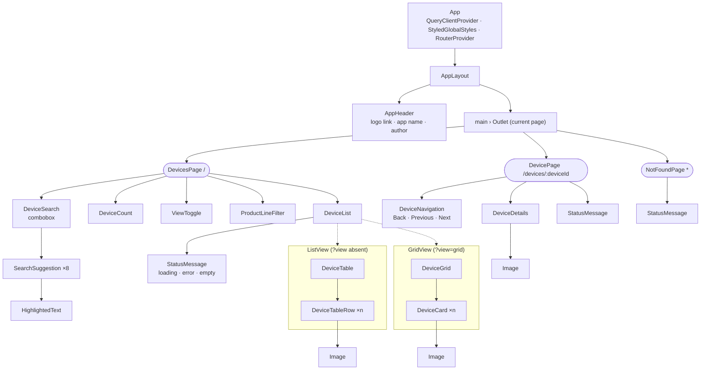
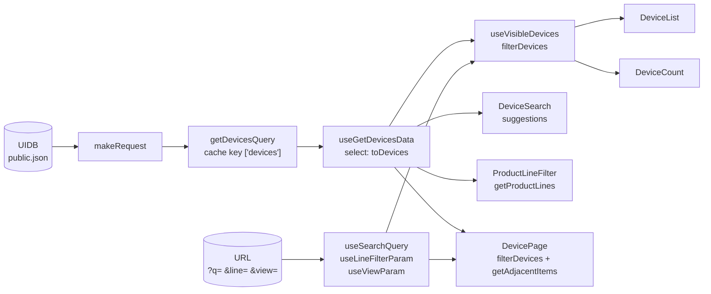
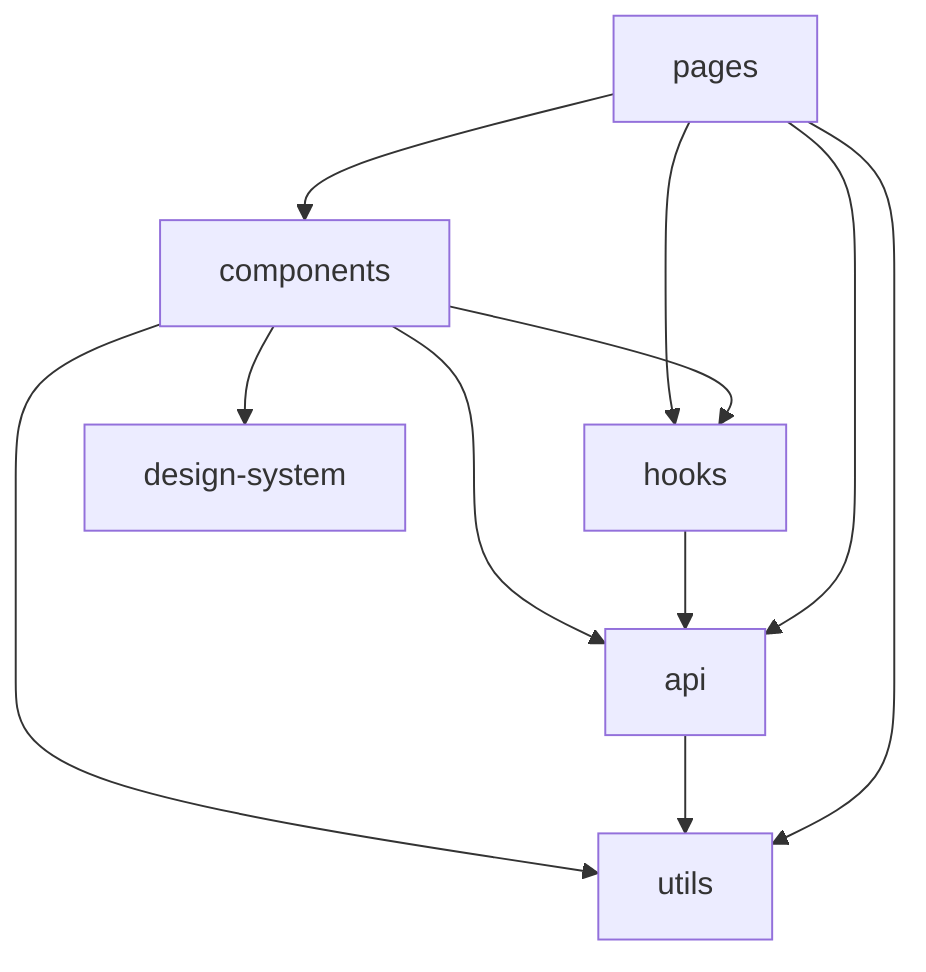

# UIDB Explorer

An internal tool to browse **UIDB**, Ubiquiti's product database: every device with its image,
product line and details. Search, filter by product line, switch between a table and a grid, and
open any device for its details. Built from the _Ubiquiti Frontend Test Assignment 2026_ Figma
design.

> **Live app:** _added after the first Vercel deployment._

## Features

- **Device list** loaded from the public UIDB snapshot, as a **table** or a **grid of cards**.
- **Search** by name or product line, with **suggestions** to jump straight to a device
  (keyboard friendly: ↓ ↑ Enter Escape).
- **Product line filter** with checkboxes, combined with the search.
- **Device count** that follows the search and the filter.
- **Device page** with image and details, plus **Back**, **Previous** and **Next** that stay
  within the current results.
- **Shareable state:** the search, filter and layout live in the URL, so reloads, bookmarks,
  shared links and the browser's back button all work.
- **Resilient to data changes:** records without an id are skipped, missing fields get readable
  defaults, and missing or broken images show a placeholder.
- **Accessible:** semantic HTML, landmarks, labelled controls, keyboard support and live
  announcements for screen readers.

## Tech stack

| Area         | Choice                                                                |
| ------------ | --------------------------------------------------------------------- |
| UI           | React 19, TypeScript 6 (strict)                                       |
| Build        | Vite 8                                                                |
| Routing      | React Router 8                                                        |
| Server data  | TanStack Query 5                                                      |
| Styling      | styled-components 6, design tokens as CSS variables, self-hosted Lato |
| Tests        | Jest 30, React Testing Library, user-event, jest-dom                  |
| Code quality | ESLint 9 (type-aware, React, hooks, jsx-a11y strict), Prettier        |
| Tooling      | Node 24, Yarn 4 (`node_modules` linker), GitHub Actions               |

## Getting started

Requirements: **Node 24** and **Yarn 4**. The versions are pinned in `.nvmrc` and in the
`packageManager` field of `package.json`.

1. Use the project's Node version:

   ```bash
   nvm use
   ```

2. Let Node's Corepack provide the project's Yarn version:

   ```bash
   corepack enable
   ```

3. Install the dependencies:

   ```bash
   yarn install
   ```

4. Start the development server, then open http://localhost:5173:

   ```bash
   yarn dev
   ```

No configuration or backend is needed: the app reads the public UIDB snapshot
(`https://static.ui.com/fingerprint/ui/public.json`) directly from the browser.

## Scripts

| Script               | What it does                                                     |
| -------------------- | ---------------------------------------------------------------- |
| `yarn dev`           | Development server with hot reload                               |
| `yarn build`         | Type check, then production build into `dist/`                   |
| `yarn preview`       | Serve the production build locally                               |
| `yarn test`          | Unit and component tests                                         |
| `yarn test:coverage` | Tests with a coverage report in `coverage/`                      |
| `yarn lint`          | ESLint; warnings fail too                                        |
| `yarn lint:fix`      | ESLint with automatic fixes (import order, blank lines…)         |
| `yarn format`        | Format every file with Prettier                                  |
| `yarn type:check`    | TypeScript type check                                            |
| `yarn check`         | Format check, lint, type check and tests: run it before a commit |

## Project structure

```text
src/
├── main.tsx              Entry point: renders <App /> into #root
├── App.tsx               Providers: query cache, global styles, router
├── router.tsx            Routes: /, /devices/:deviceId, and a catch-all
├── paths.ts              Builds every URL, so links and routes never drift apart
├── queryClient.ts        TanStack Query defaults (retries, refetching)
├── api/                  Everything about talking to UIDB
│   ├── helpers/          makeRequest: the single way to call a server
│   ├── queries/          getDevicesQuery: the GET request and its cache key
│   ├── models/           Device type, parsing and the pure functions on devices
│   └── useGetDevicesData.ts   Hook: parsed devices with loading and error state
├── hooks/                URL state (search, filter, layout) and the visible devices
├── pages/                One component per route: DevicesPage, DevicePage, NotFoundPage
├── components/           App components, one folder each
│   ├── ListView/         The table layout (DeviceTable, DeviceTableRow)
│   └── GridView/         The grid layout (DeviceGrid, DeviceCard)
├── design-system/        Reusable, app-independent: tokens, global styles, icons,
│                         Icon, Image, HighlightedText
├── utils/                Generic helpers (isNullOrUndefined, matchesSearch…)
└── test/                 Test helpers (renderWithProviders, createQueryWrapper)
test/                     Jest setup, transforms and stubs
.github/workflows/        CI: the Verify pipeline
```

## Architecture

### Component tree

How the components nest at runtime. Rounded boxes are pages; the dashed boxes are the two
layouts, of which `DeviceList` shows one.



### Data flow

UIDB is downloaded **once** and cached. Every component that needs devices reads the same cache,
and the URL decides which of them are visible.



1. **`makeRequest`** (`api/helpers`) is the only code that calls `fetch`. It adds shared
   defaults, such as the JSON `Accept` header.
2. **`getDevicesQuery`** (`api/queries`) is the GET request plus its cache key. It returns the
   JSON **as UIDB sent it**, typed `unknown`, because UIDB doesn't guarantee its schema.
3. **`useGetDevicesData`** parses that JSON with **`toDevices`** in TanStack Query's `select`
   step. Parsing runs once per response, and a malformed response becomes a normal error state
   instead of a crash.
4. **`useVisibleDevices`** combines the devices with the search and filter from the URL through
   **`filterDevices`**. The list and the count both use it, so they always agree.
5. **`DevicePage`** uses the same `filterDevices`, so Previous and Next step through exactly the
   devices the list showed.

### Layers and dependency rules

Imports only go one way. Nothing imports "upwards", so there are no import cycles, and the
design system could become its own package.



| Layer            | Holds                                     | May import                       |
| ---------------- | ----------------------------------------- | -------------------------------- |
| `pages/`         | One component per route                   | components, hooks, api, utils    |
| `components/`    | App components                            | hooks, api, design-system, utils |
| `hooks/`         | URL state and derived data                | api                              |
| `api/`           | Requests, parsing, device models          | utils                            |
| `design-system/` | Tokens, global styles, generic components | nothing from the app             |
| `utils/`         | Generic, framework-free helpers           | nothing                          |

Every folder exposes its public API through an `index.ts` barrel. Other folders import the
barrel (`'../../design-system'`), never a file inside it. Inside a folder, files import each other
directly. ESLint enforces the design-system barrel.

### State: what lives where

| State                      | Where                   | Why                                             |
| -------------------------- | ----------------------- | ----------------------------------------------- |
| Devices from UIDB          | TanStack Query cache    | Downloaded once, shared, retried on failure     |
| Search text                | URL `?q=`               | Shareable; survives reloads and navigation      |
| Selected product lines     | URL `?line=` (repeated) | Same; several lines without a custom separator  |
| Layout (table or grid)     | URL `?view=grid`        | Same; the table is the default and adds nothing |
| Open dropdowns, highlights | Component `useState`    | Temporary UI state: not worth sharing           |

Device links carry the list's URL parameters (`/devices/u6?q=dream&view=grid`), so the device
page knows the current results, and **Back** restores the list exactly.

### Key decisions

- **Tolerant parsing.** UIDB's schema isn't guaranteed. `toDevices` requires only an `id`, gives
  readable defaults ("Unnamed device", "Unknown") for missing fields, and skips invalid records
  instead of failing the whole list.
- **Design tokens.** The Figma style guide lives in `design-system/tokens/tokens.ts` as typed
  values, published as CSS variables (`--uidb-color-primary`). Components only use tokens, never
  raw colours or sizes.
- **Images.** URLs come from the UI image service (`getDeviceImageUrl`), requested at twice the
  displayed size for sharp high-density screens. `Image` falls back to a placeholder when an
  image is missing or fails, and loads lazily.
- **Accessibility first.** Landmarks (`header`, `main`, `nav`, `search`), one `h1` per page, a
  real table with column headers, a list for the grid, an ARIA combobox for the suggestions
  (`aria-activedescendant`), a disclosure with a `fieldset` for the filter, `aria-pressed` for
  the layout toggle, and `<output>` for the live count.

## Testing

- **Jest + React Testing Library**, with the test next to its file: `DeviceCard.test.tsx` beside
  `DeviceCard.tsx`.
- Tests find elements **by role and accessible name**, as users and screen readers do. A test
  failing to find `getByRole('button', { name: 'Grid view' })` usually means the markup lost its
  semantics.
- Titles read as behaviour: `test('Should …')`.
- **`renderWithProviders`** (`src/test`) renders a component with a fresh query cache and an
  in-memory router, and returns `router` and `user` for navigation and interaction.
- **The network is never used.** `test/setupTests.ts` makes `fetch` fail unless a test mocks
  it, for example with
  `jest.spyOn(globalThis, 'fetch').mockResolvedValue(Response.json({ devices: [] }))`.
- `toHaveStyleRule` (jest-styled-components) checks CSS where it matters, such as the `Icon` mask.

Jest runs TypeScript through **ts-jest** in transpile-only mode; `yarn type:check` does the type
checking. The `test/` folder holds the pieces Jest needs for this Vite project:

- asset and CSS stubs;
- a transform that compiles the ESM-only React Router to CommonJS;
- a stub for its server-only `cookie-es` dependency.

## Code conventions

Most of these are enforced by ESLint, so `yarn lint` reports any slip.

- **One React component per file**, with its test beside it; styles in
  `ComponentName.styles.ts`.
- **Arrow functions** only; **no classes**; **named exports** only (no `export default`).
- Styled components are named **`Styled<Name>`**; style-only props are transient (`$isActive`).
- Import the **design system through its barrel** only.
- **Sorted imports** (packages, then aliases, then relative), **generic array types**
  (`Array<T>`, `ReadonlyArray<T>`), and a **blank line before `return`**. All three are
  auto-fixable with `yarn lint:fix`.
- `async`/`await` with `try`/`catch` rather than chained `.then()` or `.catch()`; check
  `null`/`undefined` with `isNullOrUndefined`.
- Every network request goes through **`makeRequest`**. Each GET has a query (`get…Query`) and,
  when the UI needs prepared data, a data hook (`use…Data`).
- Commits follow **Conventional Commits** (`feat:`, `fix:`, `test:`, `chore:`, `ci:`, `docs:`…),
  one user-visible change per commit.

## Continuous integration

`.github/workflows/verify.yml` runs on every push to `main` and every pull request. It installs
the locked dependencies (`yarn install --immutable`), then runs the format check, lint, type
check, tests and a production build. A failing step marks the commit with a red ✗ on GitHub.

## Deployment

The production build (`yarn build`) is a static site in `dist/`, so any static host can serve it.
The app will be published on **Vercel**; the live URL and the setup steps are added here after
the first deployment.

## Author

Sameh Albarbarawi
